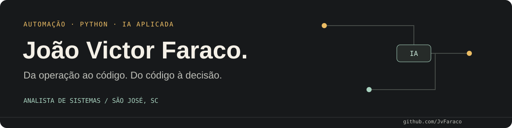

**Analista de Sistemas na Orsegups · São José, SC**

Desenvolvo automações e sistemas que conectam **operações, dados e inteligência artificial**. Minha experiência combina Python, integração de APIs, aplicações web e geoprocessamento — da coleta de dados à ferramenta usada pela equipe.

[Portfólio e estudos de caso](https://jvfaraco.github.io/jvfaraco-portifolio/) · [LinkedIn](https://www.linkedin.com/in/jo%C3%A3o-victor-faraco-01066423a/) · [Contato](mailto:joaovictorfaraco@gmail.com)

## O que você encontra no meu trabalho

- **IA com critérios claros:** regras determinísticas antes do modelo, contexto sanitizado, classificação restrita ao catálogo e decisão final humana.
- **Integrações que consideram falhas:** rotação de tokens, deduplicação, reconciliação, simulação e conferência depois da escrita.
- **Dados úteis para a operação:** coletores, indicadores, relatórios Excel e mapas de filas e cobertura territorial.
- **Qualidade verificável:** testes offline, contratos medidos e minimização de dados pessoais.

## Projetos públicos

| Projeto | Problema e solução | Explorar |
|---|---|---|
| **Route Coverage Map** | Converte descrições de rotas em mapa: geocodificação progressiva, limites IBGE, fallback geométrico e recorte de sobreposições. Demo com dados fictícios. | [Código](https://github.com/JvFaraco/mapaderotas) · [Demo](https://jvfaraco.github.io/mapaderotas/) |
| **Operations Dashboard Platform** | Normaliza planilhas em Python e reúne OS, agendas, pendências, risco e cobertura em cinco módulos. Demo pública estática e fictícia; backend Flask no repositório. | [Código](https://github.com/JvFaraco/operational-dashboard-platform) · [Demo](https://jvfaraco.github.io/operational-dashboard-platform/) |
| **Bot de alertas no Telegram** | Monitora produtos e ofertas com critérios de preço, desconto e palavras-chave. Envia alertas, deduplica notificações e roda pelo GitHub Actions. | [Código](https://github.com/JvFaraco/bot-telegram) |

## Estudos de caso de sistemas internos

Os repositórios são privados. O portfólio apresenta problemas e decisões de engenharia, sem expor código, credenciais ou dados operacionais.

| Sistema | O que desenvolvi | Engenharia aplicada |
|---|---|---|
| **Validador de OS com IA** | Pré-validação de pós-venda e instalação: coleta dados, lê documentos por OCR local, aplica regras e prepara classificação/observação para conferência humana. | Python, Copilot Studio, JSON Schema, OCR, SQLite, locks e reconciliação |
| **Portal Operacional A365** | Portal com autenticação, dashboards de OS e produtividade, cobertura de rotas e auditoria de contas. | FastAPI, SQLite, JavaScript, coleta incremental e projeção de dados |
| **Integração de OS com CRM** | Sincronização de contrato/RPL, timeline e respostas do cliente, com acompanhamento de mudanças e prevenção de anexos duplicados. | Python, APIs HTTP, PDF, rotação de tokens e estado por operação |
| **Ferramentas de campo e agenda** | Relatórios de comissão e equipamentos removidos, auditoria de contas/rotas, reagendamento e assistente de recomendação de agenda. | Python, openpyxl, testes offline, extensão Chrome e regras por contexto |

**Evidência de qualidade:** a suíte local do validador registrou **1.503 testes passando em 12/10/2026**. É um snapshot desse projeto, não uma taxa de sucesso da IA ou uma métrica de produtividade. O assistente de agenda mantém limitações documentadas, como bloqueios não verificados e durações que precisam de calibração operacional.

## Stack com contexto

| Área | Tecnologias e práticas |
|---|---|
| Automação e backend | Python, FastAPI, Flask, APIs HTTP, processamento de PDF, openpyxl |
| IA aplicada | Copilot Studio, Azure OpenAI, OCR local, engenharia de contexto, regras determinísticas, JSON Schema |
| Dados e visualização | pandas, SQL/SQLite, Power BI, JavaScript, Chart.js |
| Geoprocessamento | Leaflet, Shapely, IBGE, geocodificação e geometria de cobertura |
| Entrega e qualidade | Git/GitHub, GitHub Actions, pytest, Playwright, Linux, documentação de contratos e simulação |

## Trajetória

**Orsegups — Analista de Sistemas** · março/2025 — atual 
Automação, integrações, pré-validação com IA, coletores, dashboards e cobertura geográfica. Atuação próxima de operação, suporte e backoffice.

**Orsegups — Especialista em Testes de Hardware** · setembro/2024 — março/2025 
Dashboards do ciclo de vida dos equipamentos e organização dos fluxos de teste de novos equipamentos e RMA.

**Figueirense Futebol Clube — Estagiário de TI** · fevereiro/2024 — setembro/2024 
Suporte técnico e manutenção de infraestrutura.

**Instituto São José — Estagiário de TI** · outubro/2022 — outubro/2023 
Suporte técnico e administração de sistemas.

## Formação

- **MBA em Inteligência Artificial**, Estácio de Sá — em andamento.
- **Gestão da Tecnologia da Informação**, Estácio de Sá — concluída em 2025.
- **Python Completo do Zero ao Avançado + Projetos Reais**, Udemy — julho/2022.

Outras certificações

- Aplicação da Melhoria Contínua — junho/2024.
- Implantação de Governança de TI — junho/2024.
- Gestão de Projetos e de Informação — março/2024.
- Programação para Internet — agosto/2023.

## Vamos conversar

Tenho interesse em oportunidades de **automação, desenvolvimento Python e IA aplicada** que aproximem engenharia e necessidades reais da operação.

**[joaovictorfaraco@gmail.com](mailto:joaovictorfaraco@gmail.com)** · [LinkedIn](https://www.linkedin.com/in/jo%C3%A3o-victor-faraco-01066423a/) · [Portfólio](https://jvfaraco.github.io/jvfaraco-portifolio/)
