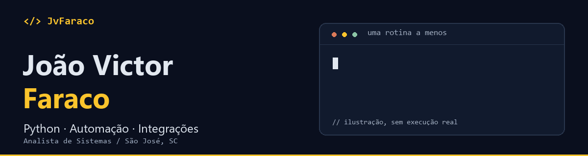
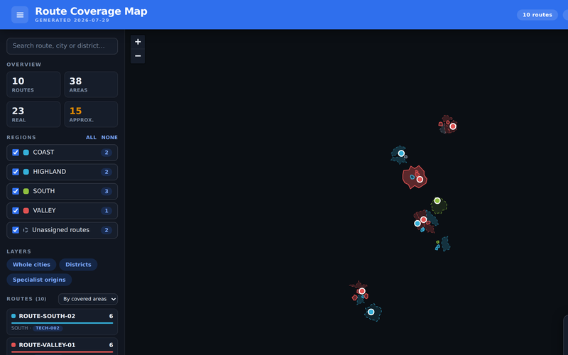
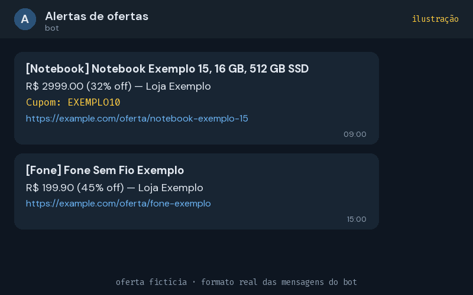
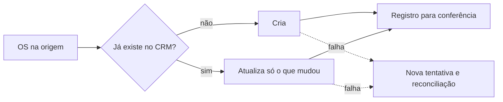
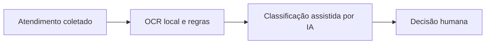

<a href="https://jvfaraco.github.io/jvfaraco-portifolio/">
  <picture>
    <source media="(prefers-reduced-motion: reduce)" srcset="assets/profile-banner.png" />
    
  </picture>
</a>

### Oi, eu sou o João 👋
**Analista de Sistemas na Orsegups · São José, SC**

Desenvolvo com Python para **automatizar tarefas, conectar sistemas e organizar dados**: APIs, aplicações web, dashboards e mapas. Comecei no suporte e passei por testes de hardware, por isso olho para o código e também para quem vai usar a ferramenta. IA entra em projetos específicos de leitura e classificação — junto com regras e conferência humana.

[**Conheça meu portfólio ↗**](https://jvfaraco.github.io/jvfaraco-portifolio/) · [LinkedIn](https://www.linkedin.com/in/jo%C3%A3o-victor-faraco-01066423a/) · [E-mail](mailto:joaovictorfaraco@gmail.com)

### Alguns projetos para explorar
<table><tr>
<td width="50%" valign="top"> <b>🗺️ Route Coverage Map</b> De uma planilha de rotas a um mapa navegável: geocodificação, limites do IBGE e tratamento das áreas de cobertura. <code>Python</code> <code>Leaflet</code> <code>GIS</code> · <a href="https://jvfaraco.github.io/mapaderotas/">Demo</a> · <a href="https://github.com/JvFaraco/mapaderotas">Código</a></td>
<td width="50%" valign="top"> <b>📬 Bot de alertas no Telegram</b> Monitoramento de ofertas com filtros de preço, desconto e palavras-chave. Envia alertas sem repetir notificações e roda pelo GitHub Actions. <code>Python</code> <code>Scraping</code> <code>Telegram API</code> · <a href="https://github.com/JvFaraco/bot-telegram">Código</a></td>
</tr></table>

O mapa é uma captura da demo, com dados fictícios. O bot é uma ilustração no formato real das mensagens, com oferta fictícia.

### O trabalho que acontece nos bastidores
Também desenvolvo ferramentas internas para a operação: integrações de OS com CRM, relatórios, auditorias e pré-validação de atendimentos. Os estudos estão no [portfólio](https://jvfaraco.github.io/jvfaraco-portifolio/).

<strong>Ver sistemas internos e decisões técnicas</strong>

| Sistema | O que resolve |
|---|---|
| **Integração de OS com CRM** | Sincroniza contratos, anexos e timeline; considera mudanças, deduplicação e falhas de comunicação. |
| **Ferramentas de campo e agenda** | Relatórios de comissão/equipamentos, auditoria de rotas, reagendamento e recomendação de agenda. |
| **Validador de OS com IA** | Combina coleta, OCR local e regras com classificação assistida por IA; a decisão final continua humana. |

Dois fluxos simplificados, sem nomes de sistemas nem dados: a sincronização de OS com o CRM e a pré-validação de atendimentos.

Cuido também do que acontece quando a API falha: simulação, reconciliação e conferência das alterações. Os repositórios são privados; os estudos não expõem credenciais nem dados operacionais.

A suíte local do validador registrou **1.503 testes passando em 12/10/2026**. É uma medição desse projeto, não uma taxa de acerto da IA. O assistente de agenda está em validação: bloqueios e duração dos atendimentos ainda precisam de conferência operacional.

### Competências
- **Python e automação de processos:** scripts, rotinas agendadas, planilhas e scraping. Bot de alertas, Route Coverage Map e ferramentas internas.
- **Integração de sistemas e APIs REST:** consumo de APIs e sincronização com deduplicação, nova tentativa e reconciliação. Integração de OS com CRM e bot de alertas.
- **Dados:** pandas, SQL/SQLite, pipelines (ETL) e Power BI. Route Coverage Map e relatórios internos.
- **Backend e web:** FastAPI e JavaScript.
- **Qualidade e entrega:** Git, GitHub Actions (CI/CD) e pytest. CI do Route Coverage Map e suíte do validador de OS.
- **IA aplicada:** Copilot Studio, Azure OpenAI, OCR e JSON Schema, com decisão final humana. Validador de OS com IA.
- **Privacidade de dados e documentação:** minimização de PII e documentação de arquitetura e operação. Varredura de PII no CI do mapa e sanitização no validador.

### De onde venho e o que estou estudando
**Orsegups — Analista de Sistemas** · desde março/2025 
Automação, integrações e ferramentas para operação, suporte e backoffice.

**MBA em Inteligência Artificial** · Estácio de Sá · em andamento

Formação, trajetória anterior e cursos

- **Gestão da Tecnologia da Informação** · Estácio de Sá · concluída em 2025.
- **Orsegups:** Especialista em Testes de Hardware · set/2024–mar/2025. Dashboards de equipamentos, testes e RMA.
- **Figueirense Futebol Clube:** Estagiário de TI · fev–set/2024. Suporte e manutenção de infraestrutura.
- **Instituto São José:** Estagiário de TI · out/2022–out/2023. Suporte e administração de sistemas.
- Python Completo do Zero ao Avançado + Projetos Reais — Udemy, jul/2022.
- Aplicação da Melhoria Contínua e Implantação de Governança de TI — jun/2024.
- Gestão de Projetos e de Informação — mar/2024.
- Programação para Internet — ago/2023.

### Vamos conversar?
Aberto a oportunidades de **desenvolvimento Python, automação e integração de sistemas**, com IA aplicada como diferencial.

**[joaovictorfaraco@gmail.com](mailto:joaovictorfaraco@gmail.com)** · [LinkedIn](https://www.linkedin.com/in/jo%C3%A3o-victor-faraco-01066423a/) · [Portfólio](https://jvfaraco.github.io/jvfaraco-portifolio/)
