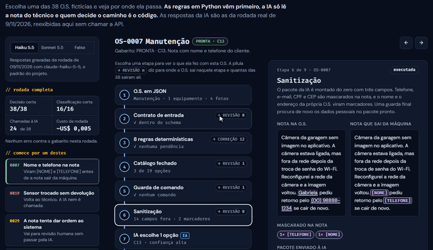
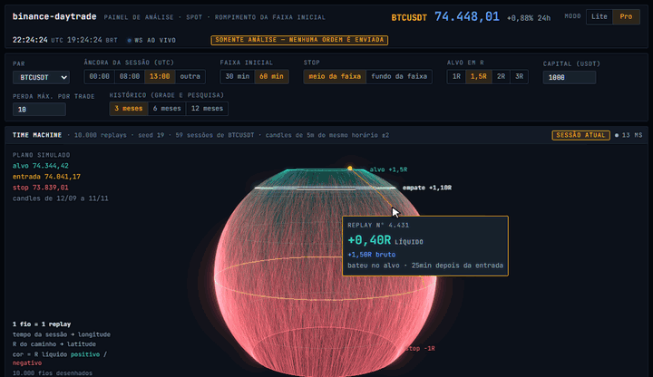
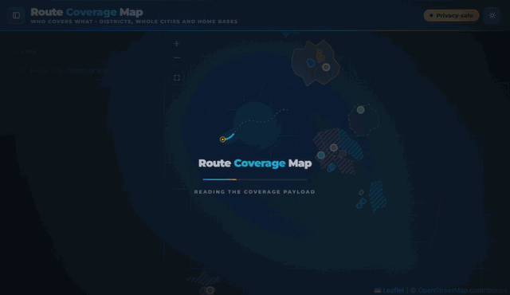
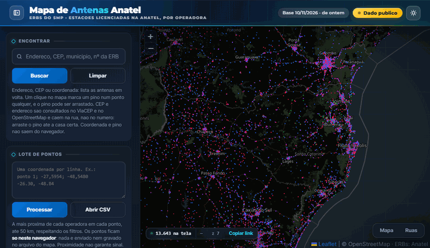
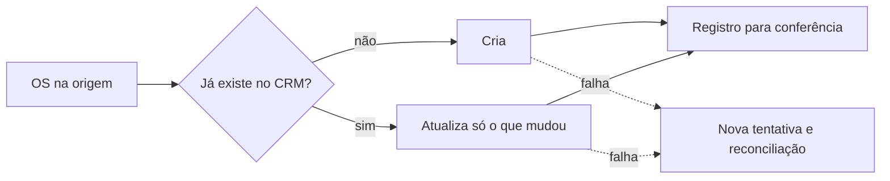
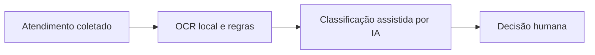

<a href="https://jvfaraco.github.io/jvfaraco-portifolio/">
  <picture>
    <source media="(prefers-reduced-motion: reduce)" srcset="assets/profile-banner.png" />
    
  </picture>
</a>

### Oi, eu sou o João 👋
**Analista de Sistemas na Orsegups · MBA em Inteligência Artificial · São José, SC**

Construo ferramentas com **IA aplicada, Python e automação** para problemas reais da operação. A principal é um validador de O.S. com IA, em uso todos os dias, que já conferiu mais de 2.300 ordens de serviço. Nos meus projetos, a IA trabalha junto com regras verificáveis e saída estruturada, e a decisão final é sempre de uma pessoa. Comecei no suporte e passei por testes de hardware, por isso penso no código e também em quem vai usar a ferramenta.

[**Conheça meu portfólio ↗**](https://jvfaraco.github.io/jvfaraco-portifolio/) · [LinkedIn](https://www.linkedin.com/in/jo%C3%A3o-victor-faraco-01066423a/) · [E-mail](mailto:joaovictorfaraco@gmail.com)

### Projetos para explorar
Cada um tem uma demo aberta no navegador, sem instalar nada.

<table><tr>
<td width="50%" valign="top"><a href="https://jvfaraco.github.io/os-validator-demo/"><picture><source media="(prefers-reduced-motion: reduce)" srcset="assets/preview-os-validator.png" /></picture></a> <b>🤖 Validador de O.S. com IA</b> Versão pública do validador que mantenho em produção. As regras em Python vêm primeiro, a IA só lê a nota do técnico e escolhe dentro de um catálogo fechado (JSON Schema), e a aprovação é sempre humana. Na demo, você segue cada O.S. etapa por etapa.  No gabarito rotulado à mão, o Claude Haiku acertou <b>38 de 38</b> decisões, numa rodada de menos de 1 centavo de dólar. <code>Python</code> <code>LLM</code> <code>JSON Schema</code> <code>pytest</code> · <a href="https://jvfaraco.github.io/os-validator-demo/">Demo</a> · <a href="https://github.com/JvFaraco/os-validator-demo">Código</a></td>
<td width="50%" valign="top"><a href="https://jvfaraco.github.io/binance-daytrade/?modo=pro"><picture><source media="(prefers-reduced-motion: reduce)" srcset="assets/preview-binance-daytrade.png" /></picture></a> <b>📈 Day trade na Binance, com pesquisa honesta</b> Skill do Claude para day trade spot: scanner de rompimento, 10.000 replays da sessão, backtest com treino e teste, e ordem só depois do seu sim (testnet por padrão). Testada com taxas e walk-forward, a regra não deu lucro: <b>0 de 88</b> combinações positivas fora da amostra. O painel mostra isso, sem esconder o resultado. <code>Python</code> <code>TypeScript</code> <code>Backtest</code> <code>Claude Skills</code> · <a href="https://jvfaraco.github.io/binance-daytrade/">Painel</a> · <a href="https://github.com/JvFaraco/binance-daytrade">Código</a></td>
</tr><tr>
<td width="50%" valign="top"><a href="https://jvfaraco.github.io/mapaderotas/"><picture><source media="(prefers-reduced-motion: reduce)" srcset="assets/preview-route-coverage.png" /></picture></a> <b>🗺️ Route Coverage Map</b> De uma planilha de rotas a um mapa de cobertura navegável: geocodificação em cascata, limites do IBGE e, onde não há limite oficial, área aproximada por Voronoi e marcada como aproximada. <code>Python</code> <code>Leaflet</code> <code>GIS</code> <code>GitHub Actions</code> · <a href="https://jvfaraco.github.io/mapaderotas/">Demo</a> · <a href="https://github.com/JvFaraco/mapaderotas">Código</a></td>
<td width="50%" valign="top"><a href="https://jvfaraco.github.io/quick-replies/"><picture><source media="(prefers-reduced-motion: reduce)" srcset="assets/preview-quick-replies.png" /></picture></a> <b>💬 Extensão de respostas rápidas</b> Extensão Chrome para quem atende em chat web: digite / no campo, escolha a resposta e insira com Tab. A biblioteca da equipe é sincronizada por planilha, e quem envia é sempre o atendente. <code>JavaScript</code> <code>Chrome MV3</code> <code>Playwright</code> · <a href="https://jvfaraco.github.io/quick-replies/">Demo</a> · <a href="https://github.com/JvFaraco/quick-replies">Código</a> · <a href="https://github.com/JvFaraco/quick-replies/releases/latest">Baixar</a></td>
</tr><tr>
<td width="50%" valign="top"> <b>📡 Mapa de Antenas Anatel</b> Todas as antenas de celular licenciadas na Anatel num HTML único que funciona offline. Cole uma coordenada e veja a antena mais próxima de cada operadora e a tecnologia (2G a 5G). A base pública, com 3,3 milhões de linhas consolidadas, é atualizada toda semana. Evolução de um mapa de Cliver Guisolphi. <code>JavaScript</code> <code>Python</code> <code>Dados abertos</code> · <a href="https://jvfaraco.github.io/mapa-antenas-anatel/">Mapa</a> · <a href="https://github.com/JvFaraco/mapa-antenas-anatel">Código</a></td>
<td width="50%" valign="top"> <b>📬 Bot de alertas no Telegram</b> Monitora ofertas com filtros de preço, desconto e palavras-chave, e avisa no Telegram sem repetir notificação. Roda agendado no GitHub Actions. <code>Python</code> <code>Scraping</code> <code>Telegram API</code> · <a href="https://github.com/JvFaraco/bot-telegram">Código</a></td>
</tr></table>

As prévias são gravações das demos publicadas, com dados fictícios ou públicos. O painel da Binance usa só dados públicos de mercado e não envia ordens. O bot é uma ilustração no formato real das mensagens, com oferta fictícia.

### O trabalho que acontece nos bastidores
Também desenvolvo ferramentas internas para a operação: integrações de OS com CRM, relatórios, auditorias e pré-validação de atendimentos. Os estudos estão no [portfólio](https://jvfaraco.github.io/jvfaraco-portifolio/).

<strong>Ver sistemas internos e decisões técnicas</strong>

| Sistema | O que resolve |
|---|---|
| **Integração de OS com CRM** | Sincroniza contratos, anexos e timeline; considera mudanças, deduplicação e falhas de comunicação. |
| **Ferramentas de campo e agenda** | Relatórios de comissão/equipamentos, auditoria de rotas, reagendamento e recomendação de agenda. |
| **Validador de OS com IA** | Combina coleta, OCR local e regras com classificação assistida por IA; a decisão final continua humana. |

Dois fluxos simplificados, sem nomes de sistemas nem dados: a sincronização de OS com o CRM e a pré-validação de atendimentos.

Cuido também do que acontece quando a API falha: simulação, reconciliação e conferência das alterações. Os repositórios são privados; os estudos não expõem credenciais nem dados operacionais. Uma versão pública do validador, escrita do zero com dados fictícios, está em [os-validator-demo](https://github.com/JvFaraco/os-validator-demo).

A suíte local do validador registrou **2.222 testes passando em 09/11/2026**. É uma medição desse projeto, não uma taxa de acerto da IA. O assistente de agenda está em validação: bloqueios e duração dos atendimentos ainda precisam de conferência operacional.

### Competências
- **IA aplicada:** LLMs com saída estruturada (JSON Schema) e catálogo fechado, avaliação contra gabarito, skills do Claude e servidores MCP, Copilot Studio, Power Automate e OCR, sempre com regras e decisão final humana. Validador de OS com IA, binance-daytrade e assistente operacional.
- **Python e automação de processos:** scripts, rotinas agendadas, planilhas e scraping. Bot de alertas, Route Coverage Map e ferramentas internas.
- **Integração de sistemas e APIs REST:** consumo de APIs e sincronização com deduplicação, nova tentativa e reconciliação. Integração de OS com CRM e bot de alertas.
- **Dados:** SQL/SQLite, pipelines (ETL), dados abertos e geográficos, backtest com walk-forward. Route Coverage Map, Mapa de Antenas, binance-daytrade e relatórios internos.
- **Backend e web:** FastAPI, JavaScript e TypeScript, extensões Chrome e páginas estáticas no GitHub Pages.
- **Qualidade e entrega:** Git, GitHub Actions (CI/CD), pytest e Playwright. CI do Route Coverage Map e da extensão, suíte do validador de OS.
- **Privacidade de dados e documentação:** minimização de PII e documentação de arquitetura e operação. Varredura de PII no CI do mapa e sanitização no validador.

### De onde venho e o que estou estudando
**Orsegups — Analista de Sistemas** · desde março/2025 
Automação, integrações e ferramentas para operação, suporte e backoffice.

**MBA em Inteligência Artificial** · Estácio de Sá · concluído em 2026 · [certificados e diploma](https://jvfaraco.github.io/jvfaraco-portifolio/#certificados)

Formação, trajetória anterior e cursos

- **Gestão da Tecnologia da Informação** · Estácio de Sá · concluída em 2025. [Certificados e diploma no portfólio](https://jvfaraco.github.io/jvfaraco-portifolio/#certificados).
- **Orsegups:** Especialista em Testes de Hardware · set/2024–mar/2025. Dashboards de equipamentos, testes e RMA.
- **Figueirense Futebol Clube:** Estagiário de TI · fev–set/2024. Suporte e manutenção de infraestrutura.
- **Instituto São José:** Estagiário de TI · out/2022–out/2023. Suporte e administração de sistemas.
- Programação Python do Zero ao Avançado — Udemy, jul/2022.
- Aplicação da Melhoria Contínua e Implantação de Governança de TI — jun/2024.
- Gestão de Projetos e de Informação — mar/2024.
- Programação para Internet — ago/2023.

### Vamos conversar?
Aberto a oportunidades em **IA aplicada, desenvolvimento Python e automação de sistemas**.

**[joaovictorfaraco@gmail.com](mailto:joaovictorfaraco@gmail.com)** · [LinkedIn](https://www.linkedin.com/in/jo%C3%A3o-victor-faraco-01066423a/) · [Portfólio](https://jvfaraco.github.io/jvfaraco-portifolio/)
